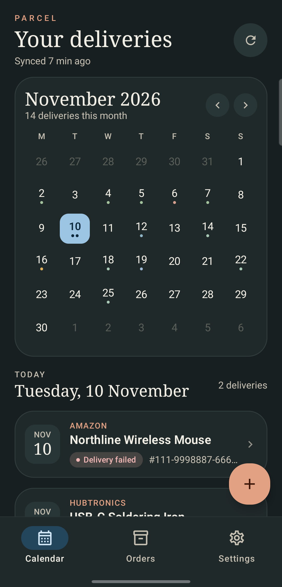
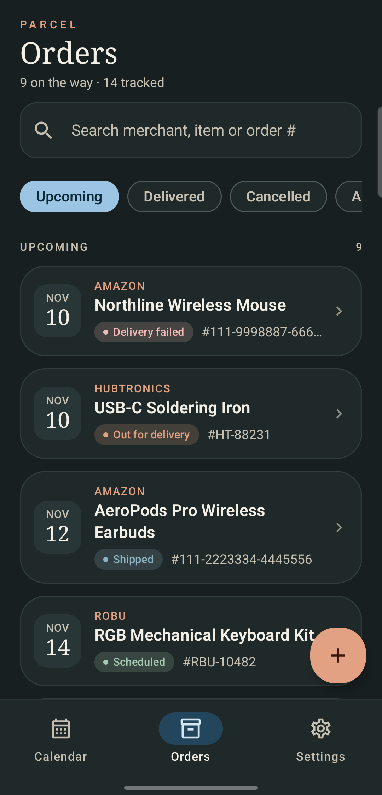
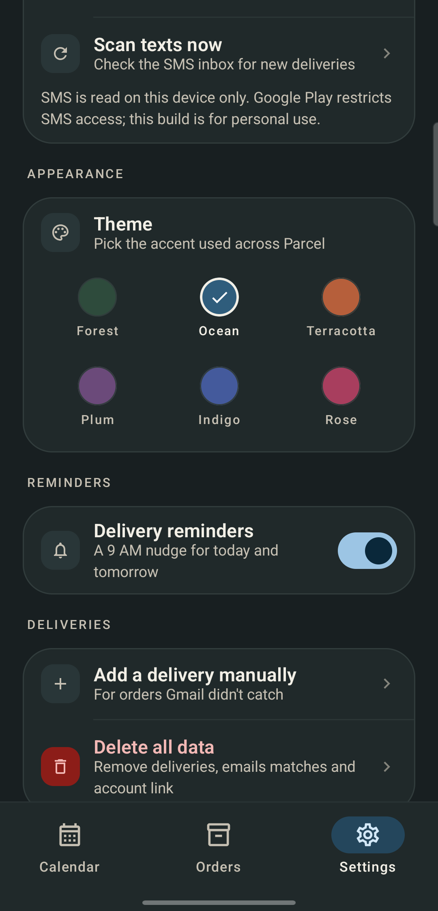
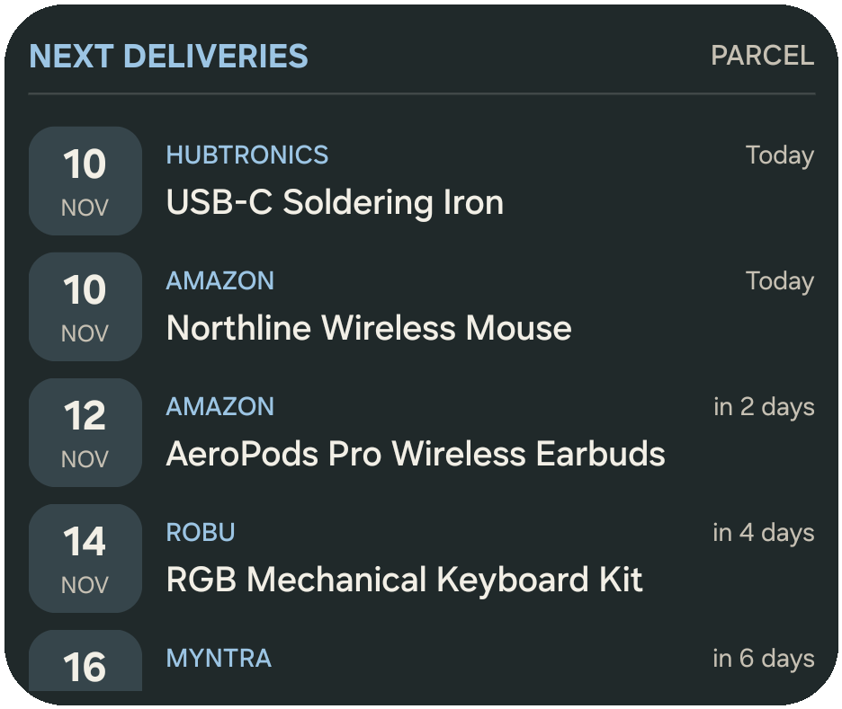

<div align="center">

# Parcel

**Every delivery. One calm calendar.**

Parcel reads order and shipping emails and delivery texts, finds the promised date, and turns the noise into a clean, private delivery tracker — with a home-screen widget that actually fits your day.

[](https://developer.android.com)
[](https://kotlinlang.org)
[](https://m3.material.io)
[](#privacy)
[](LICENSE)
[](https://github.com/adithya-s-119/parcel-tracker/releases/latest)

</div>

---

## Why Parcel

Online orders are scattered across Gmail, SMS, courier updates, and six different apps. Parcel puts them in one place without asking you to forward anything, create an account, or send your inbox to a server.

- **Reads the inbox you already have** — Gmail with a free app password, plus delivery SMS on the phone.
- **Knows what actually happened** — shipped, delayed, out for delivery, delivery failed, ready for pickup, delivered, cancelled, returned.
- **Never double-counts the same parcel** — Gmail and SMS updates merge by order number, tracking number, product, and date.
- **Stays private** — parsing happens on-device. There is no Parcel backend and no analytics.

## Screenshots

| Calendar | Orders |
|:---:|:---:|
|  |  |
| **Six color themes** | **Scrollable home-screen widget** |
|  |  |

## What it does

### Track automatically

- **Gmail app password.** Connect over IMAP in about a minute — no Google Cloud project, no OAuth client, no billing.
- **Multiple Gmail accounts.** Add every inbox you order from; Parcel scans them together and merges duplicate deliveries.
- **Delivery SMS.** Reads courier and store texts on-device, including India Post, Delhivery, Blue Dart, DTDC, Ekart, XpressBees, Shadowfax, and more.
- **Share to Parcel.** Open any order email → Share → Parcel when you want to add one manually.
- **60+ stores and couriers**, including Amazon, Flipkart, Myntra, Ajio, Meesho, Nykaa, Croma, Tata CLiQ, Reliance Digital, JioMart, DMart, FirstCry, Lenskart, Pepperfry, Vijay Sales, Sangeetha Mobiles, Bajaj Electronics, Robu, Robocraze, Hubtronics, Xcluma, Probots, Sharvie Electronics, FlyRobo, Robokits, ThinkRobotics, RhydoLABZ, Quartz Components, element14, Mouser, DigiKey, AliExpress, Newegg, B&H Photo, Costco, Wayfair, and more.
- **Promotion filter.** Sale blasts, cashback offers, movie tickets, and cinema food receipts are ignored instead of becoming fake deliveries.

### Stay ahead

- **Calendar view** with delivery dots, month navigation, and a day-by-day list.
- **Orders view** with search, delivery-status filters, manual edits, and one-tap **Mark delivered** with an **Undo** action.
- **Real status tracking**:

| Status | Meaning |
| --- | --- |
| Scheduled | Order confirmed, no shipping update yet |
| Shipped | Dispatched or in transit |
| Delayed | Carrier or store announced a delay |
| Ready for pickup | Waiting at a pickup point |
| Out for delivery | With the delivery agent today |
| Delivery failed | Attempted but not delivered |
| Delivered | Completed |
| Cancelled | Order cancelled |
| Returned to sender | Returned after a failed delivery |

- **Daily reminder** at 9 AM for deliveries arriving today or tomorrow.
- **Scrollable widget** showing up to 10 upcoming deliveries, with large readable text and the selected theme.

### Make it yours

- **Six color themes** — Forest, Ocean, Terracotta, Plum, Indigo, Rose. The whole app and widget pick up the theme.
- **Full product names** — even when the email subject truncates the title, Parcel reads the body to show the complete name in the editor.
- **Manual control** — fix a date, change a status, mark an order delivered, add notes, or delete anything.

## How it works

1. **Connect Gmail.** Create a free Google app password and paste it into Parcel. Nothing else to configure.
2. **Let Parcel scan.** Order and shipping emails are parsed locally. Delivery SMS is read only when you enable it.
3. **Open the calendar.** Your next deliveries appear by date, with clear status and one card per parcel.

The parser is deliberately conservative: it prefers an explicit delivery phrase ("arriving Thursday", "out for delivery", "delivered on") over any date in the email. If no delivery date is mentioned, the order stays undated instead of inventing one.

## Getting started

### Option A — Gmail app password (free)

1. Turn on **2-Step Verification** for your Google account.
2. Create an **App password** at `myaccount.google.com/apppasswords`.
3. In Parcel: **Settings → Connect Gmail with app password**, then enter your Gmail address and the 16-character password.
4. Repeat with **Add account** for any other Gmail inbox you want Parcel to scan.

Parcel connects to `imap.gmail.com` over TLS, opens each Gmail account read-only, and scans order mail. Every password is encrypted with an Android Keystore key and can be revoked from Google at any time.

### Option B — No email at all

Skip sign-in and add deliveries by hand, or use **Share → Parcel** from any order email.

### Delivery texts

Enable **Settings → Read delivery texts** and grant SMS permission. Messages are parsed on-device and never uploaded.

> SMS is a restricted Android permission. This build is intended for personal sideloading; publishing on Google Play requires a separate SMS policy declaration and approval.

## Install

Download the latest APK from **[Releases](https://github.com/adithya-s-119/parcel-tracker/releases/latest)**, then sideload it on Android 8.0 or newer:

```powershell
adb install -r Parcel-v1.2.1.apk
```

The release APK is a personal-sideload build. SMS access is restricted by Google Play policy, so Parcel is distributed outside the Play Store.

## Build from source

**Requirements:** JDK 17+, Android SDK 35, Android 8.0+ device or emulator.

```powershell
# Windows PowerShell
$env:JAVA_HOME = "C:\path\to\jdk-17-or-21"
$env:ANDROID_HOME = "$env:LOCALAPPDATA\Android\Sdk"

.\gradlew.bat :app:testDebugUnitTest
.\gradlew.bat :app:assembleDebug
adb install -r app\build\outputs\apk\debug\app-debug.apk
```

The debug APK is written to `app/build/outputs/apk/debug/app-debug.apk`.

## Privacy

- No server, no analytics, no third-party email processing.
- Gmail is read through a read-only IMAP folder. Nothing is sent, edited, or deleted.
- Delivery SMS is read on-device only.
- Emails, texts, and deliveries live in a local Room database.
- Every IMAP app password is encrypted at rest with Android Keystore.
- **Delete all data** in Settings removes the database, account connection, SMS settings, and app preferences.

## Architecture

| Layer | Built with |
| --- | --- |
| UI | Kotlin, Jetpack Compose, Material 3 |
| Storage | Room, DataStore |
| Background work | WorkManager |
| Widget | Jetpack Glance |
| Gmail | Read-only IMAP with a Google app password |
| Parsing | Rule-based Kotlin parser with unit tests |

The project is intentionally small and serverless: the phone does the parsing, and the only network calls are read-only Gmail requests.

## License

MIT © 2026 Adithya S. See [LICENSE](LICENSE).

## Limitations

- Date extraction is rule-based. Unusual email layouts can be missed, and every delivery can be edited manually.
- SMS scanning requires sideloading because of Google Play's SMS policy.
- Merchant coverage is broad but not infinite. New stores are easy to add in `OrderEmailParser.kt`.
- The widget shows up to 10 upcoming deliveries and scrolls inside the launcher.

## Troubleshooting

**IMAP says authentication failed** — use a 16-character app password, not your normal Google password, and make sure 2-Step Verification is enabled.

**A delivery is missing** — open Orders → All, or use Share → Parcel from the original email. Promotional mail and cinema bookings are filtered on purpose.

**SMS is not found** — grant both `READ_SMS` and `RECEIVE_SMS`, then run **Settings → Scan texts now**.

---

<div align="center">

**Parcel** — built for calm arrivals.

Open source under the MIT License · not affiliated with Google, Amazon, Flipkart, or any courier.

</div>
